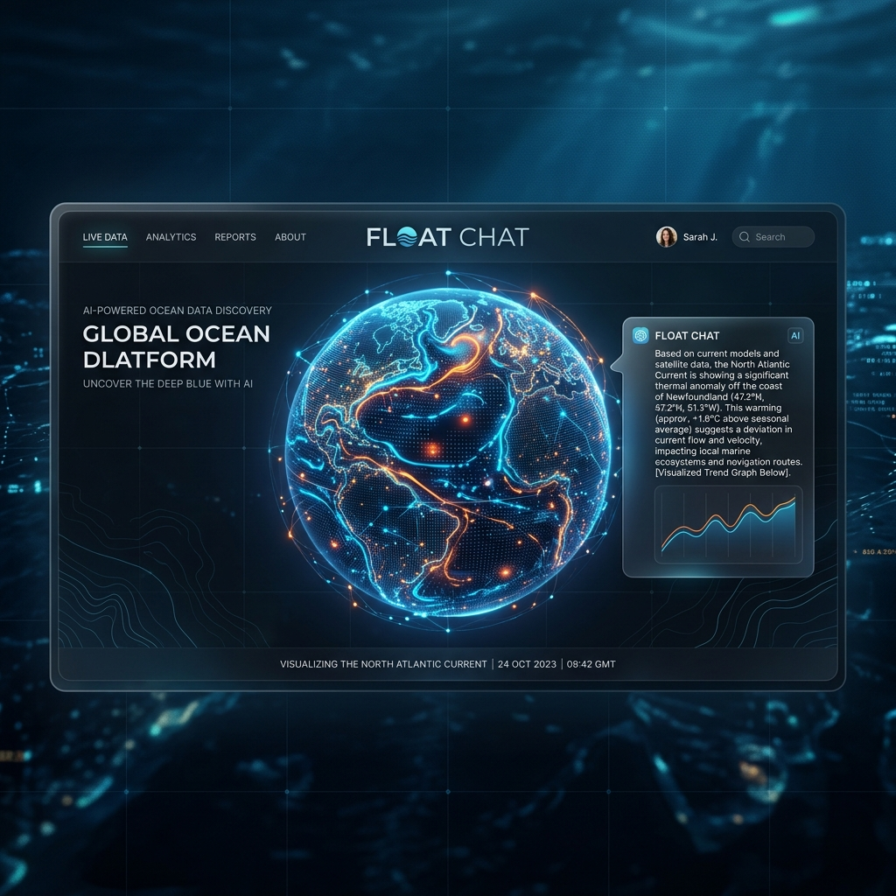
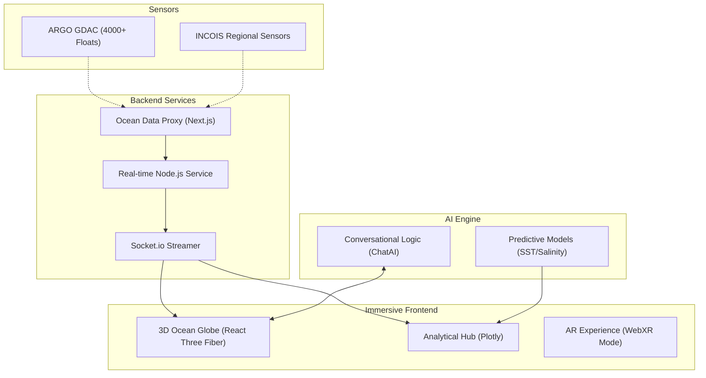
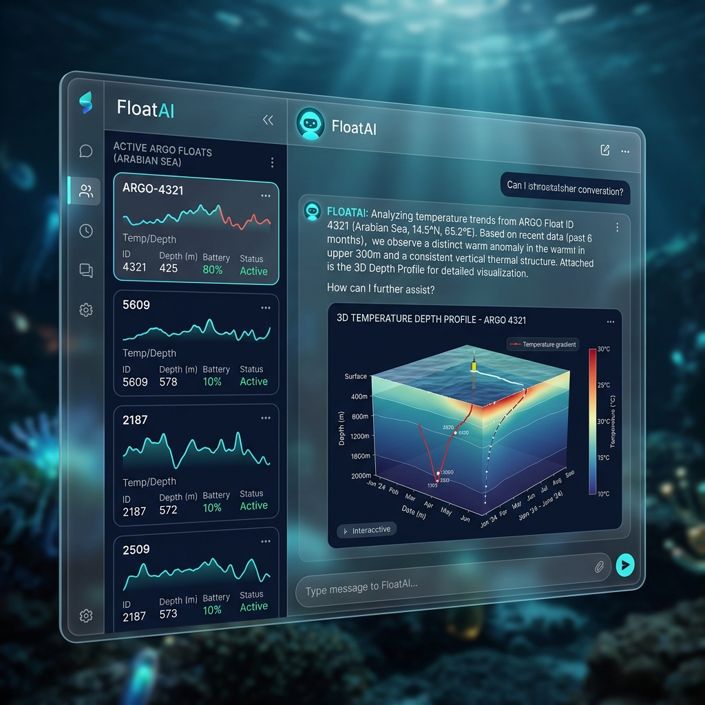
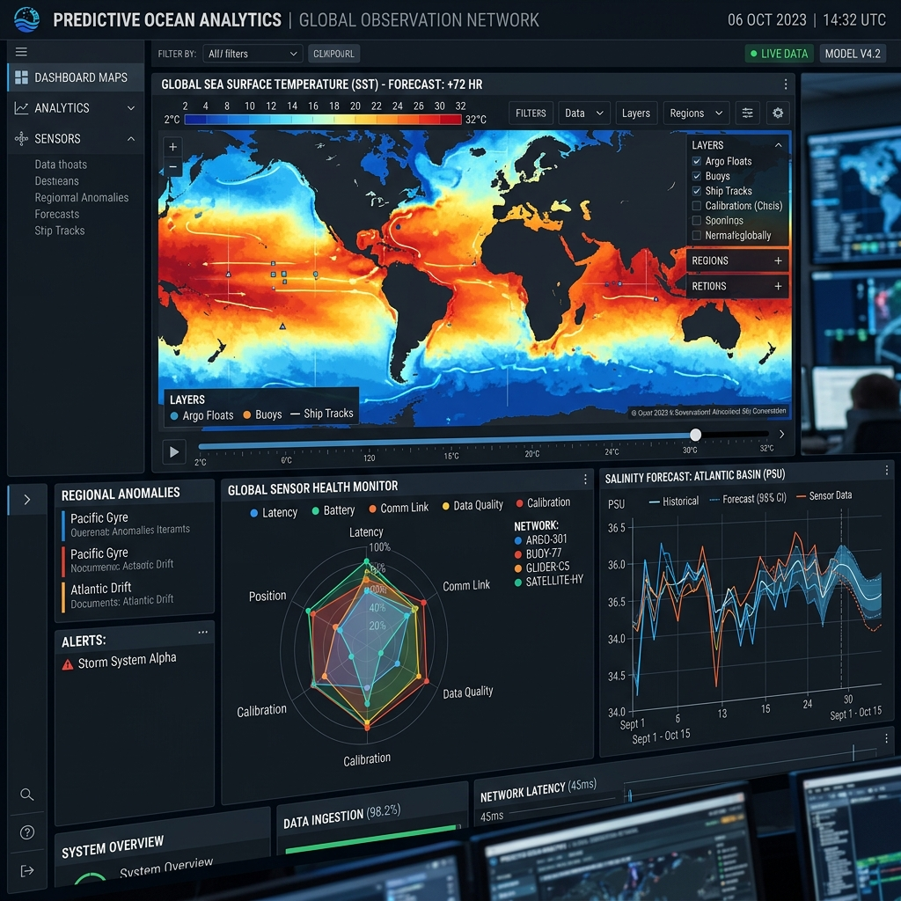

# 🌊 FLOAT CHAT: AI-Powered Ocean Intelligence

[](https://nextjs.org/)
[](https://www.typescriptlang.org/)
[](https://threejs.org/)
[](LICENSE)

FLOAT CHAT is an elite, AI-driven oceanographic platform designed to make complex sensor data accessible, intuitive, and actionable. By combining real-time data from 4,000+ ARGO floats with advanced conversational intelligence and immersive 3D visualizations, it allows users to "talk to the ocean" and uncover deep insights through natural language.

---



## 🧠 System Architecture

FLOAT CHAT leverages a high-performance sensor-to-insight pipeline, ensuring data integrity and low-latency delivery of global ocean metrics.



---

## ⚙️ Advanced Tech Stack

| Category           | Technology                           | Use Case                                  |
| ------------------ | ------------------------------------ | ----------------------------------------- |
| **Framework**      | Next.js 14 (App Router)              | Hybrid Rendering & Scalable Architecture |
| **Visual Core**    | Three.js / React Three Fiber / Drei  | 3D Immersive Ocean Globe                  |
| **AI Intelligence**| Custom LLM Integration               | Conversational Data Exploration           |
| **Data Viz**       | Plotly.js / React-Plotly             | High-Performance Analytical Charts        |
| **Motion**         | Framer Motion                        | Cinematic Transitions & UI Polish         |
| **Real-time**      | Socket.io & Event Emitters           | Live Sensor Data Orchestration            |
| **Mapping**        | Leaflet / React Leaflet              | 2D Geographic Data Overlay                |
| **State**          | Zustand                              | Global Application State Management       |

---

## 🎯 Core Features

### 1. 🗨️ AI-Powered Conversational Exploration
Ask complex oceanographic questions in natural language. The AI reasoning engine synthesizes real-time sensor data to provide deep contextual insights.



### 2. 🌍 Immersive 3D Ocean Globe
A high-fidelity 3D visualization of the Earth, showing the real-time positions of over 4,000 ARGO floats with interactive depth profiling and trajectory mapping.

### 3. 🔮 Predictive Ocean Analytics
Leverage advanced forecasting models to visualize future trends in Sea Surface Temperature (SST), Salinity, and Current speeds across various global regions.



### 4. 📲 Augmented Reality Support
Experience ocean data in your physical space using our dedicated AR mode, allowing for hands-on, intuitive exploration of ocean depth layers.

---

## 🔥 Unique Innovations

*   **Humanizing Complex Data**: We bridge the gap between technical oceanographic datasets and intuitive understanding through natural language processing.
*   **Real-time Sensor Fusion**: Automated, real-time ingestion and processing of data from global (ARGO) and regional (INCOIS) sensor networks.
*   **Contextual Insight Delivery**: Beyond just displaying numbers, the platform explains the "why" behind oceanographic shifts using AI reasoning.
*   **Cinematic Design System**: A premium, "Space-Age" UI/UX designed with glassmorphism and subtle micro-animations to wow users and stakeholders alike.

---

## 🏁 Getting Started

### Prerequisites
- Node.js LTS (v18+)
- npm / yarn

### Installation
1. **Clone & Setup**:
   ```bash
   git clone [repository-url]
   cd float-chat
   npm install
   ```
2. **Environment Configuration**:
   ```bash
   cp .env.example .env.local
   # Configure your API keys in .env.local
   ```
3. **Run Locally**:
   ```bash
   npm run dev
   ```

---

## 📂 Project Structure

```text
├── app/                  # Next.js 14 App Router
│   ├── layout.tsx        # Global Layout & Providers
│   └── page.tsx          # Main Entry Point
├── components/           # UI Component Library
│   ├── OceanGlobe.tsx    # 3D Three.js Globe
│   ├── ChatInterface.tsx # AI Chat Logic
│   └── PredictiveView.tsx# Advanced Forecasting Analytics
├── lib/                  # Processing Logic
│   ├── realOceanData.ts  # Real-time Sensor Ingestion
│   └── realtimeData.ts   # WebSocket & Event Streaming
├── public/               # Global Static Assets
└── types/                # TypeScript Interface Definitions
```

---

## 📄 License

This project is licensed under the **MIT License**. See the [LICENSE](LICENSE) file for details.

Built with ❤️ for Global Ocean Research.
